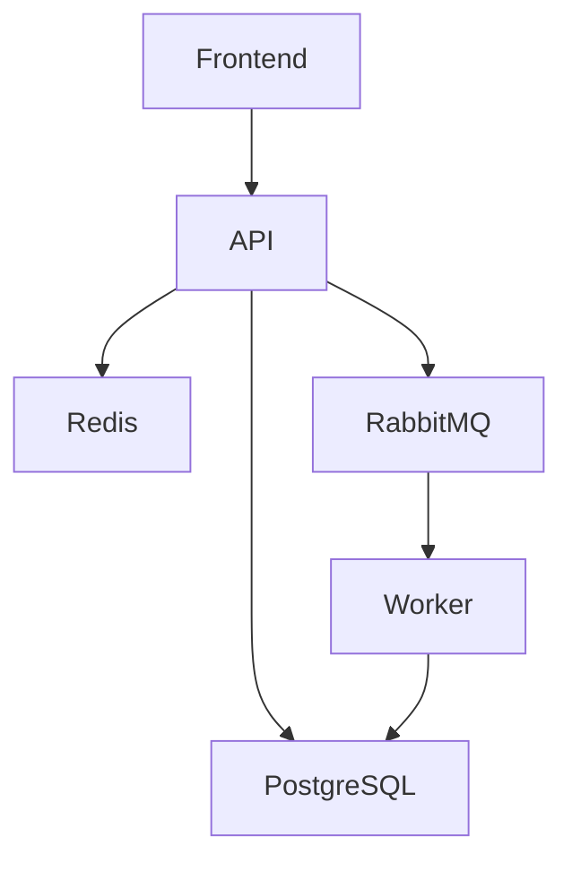

# Diseño del sistema

Diseño inicial para la prueba de reservaciones.

El proyecto tendrá un backend con NestJS y un frontend con React y Vite, dentro del mismo repositorio. El worker estará en el backend, pero se ejecutará por separado.

## Base de datos

Se usarán cuatro tablas. Los IDs serán UUID, las fechas del viaje DATE, los registros de creación y actualización TIMESTAMPTZ y los importes NUMERIC para manejar decimales.

### usuarios

- id (PK)
- nombre
- email (único)
- password_hash
- rol
- created_at

### paquetes

- id (PK)
- destino
- fecha_inicio
- fecha_fin
- precio
- cupo_total
- cupo_disponible
- created_at
- updated_at

### reservaciones

- id (PK)
- cliente_id (FK usuarios)
- creada_por_id (FK usuarios)
- paquete_id (FK paquetes)
- numero_personas
- precio_unitario
- total
- estado_pago
- created_at
- updated_at

### notificaciones

- id (PK)
- evento_id (único)
- reservacion_id (FK reservaciones)
- created_at

## Reglas

cliente_id indica a quién pertenece la reserva y creada_por_id quién la registró. Si reserva el propio cliente, ambos tendrán el mismo valor.

El precio se guardará en la reserva para conservarlo si después cambia el paquete. El total se calculará en el backend.

Los campos serán obligatorios.

Los roles serán admin, agente y cliente.

Los estados serán PENDIENTE, PAGADA y CANCELADA.

La cantidad de personas debe ser mayor que cero y los precios no negativos.

La fecha final no podrá ser anterior a la inicial.

El cupo disponible deberá estar entre cero y el cupo total.

No se permitirá borrar usuarios o paquetes asociados a reservas.

## Componentes

- Frontend: muestra paquetes y permite realizar reservaciones.
- API: valida los datos, permisos y disponibilidad.
- PostgreSQL: guarda usuarios, paquetes, reservaciones y notificaciones.
- Redis: guarda temporalmente los listados de paquetes para reducir consultas.
- RabbitMQ: recibe el evento cuando se crea una reservación.
- Worker: procesa el evento y guarda una notificación simulada.
