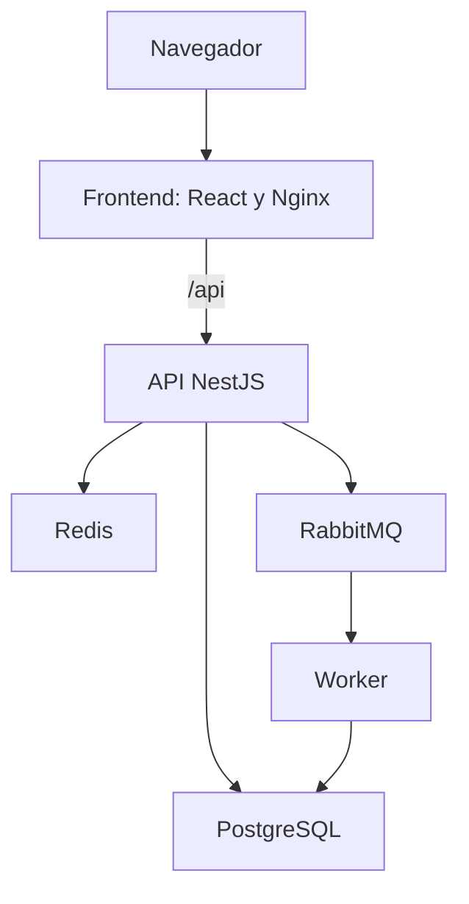
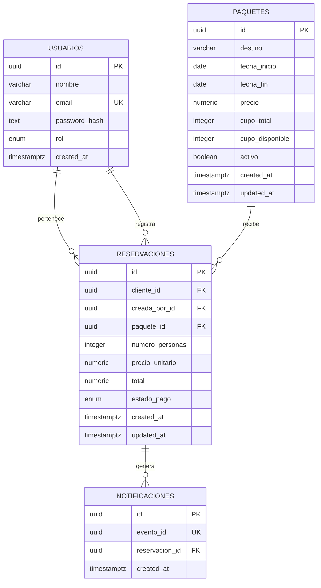
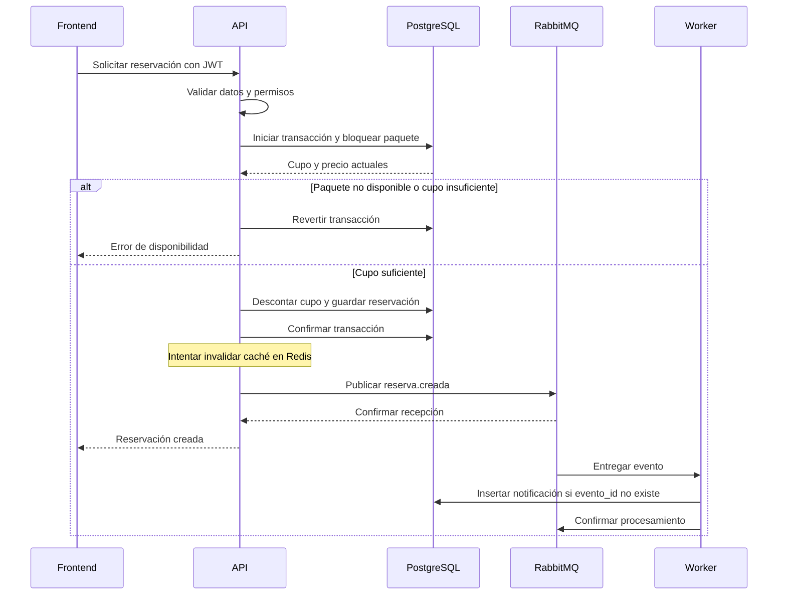

# Diseño del sistema

## Arquitectura

El repositorio contiene un frontend React y un backend NestJS.
El worker pertenece al backend, pero se ejecuta como un proceso separado.

| Componente | Responsabilidad                                               |
| ---------- | ------------------------------------------------------------- |
| Frontend   | Formularios, navegación, sesión y presentación de resultados. |
| API        | Autenticación, permisos, validaciones y reglas de negocio.    |
| PostgreSQL | Información persistente y consistencia de las reservaciones.  |
| Redis      | Caché temporal de listados de paquetes.                       |
| RabbitMQ   | Cola de eventos de reservaciones creadas.                     |
| Worker     | Procesar eventos y registrar notificaciones simuladas.        |

Nginx sirve el frontend y redirige `/api` al backend. El navegador
utiliza el mismo origen para la interfaz y las solicitudes de la API.

## Modelo de datos

`cliente_id` identifica al dueño de la reservación y `creada_por_id`
a quien la registró. Cuando reserva el propio cliente, ambos coinciden.

Los precios de paquetes y precios unitarios utilizan `NUMERIC(12,2)`.
El total de la reservación utiliza `NUMERIC(22,2)`.
Los importes se exponen como cadenas para conservar su representación decimal.

Los roles son `admin`, `agente` y `cliente`.
Los estados de pago son `PENDIENTE`, `PAGADA` y `CANCELADA`.

### Restricciones

- El email del usuario es único.
- `evento_id` es único para evitar notificaciones duplicadas.
- La fecha final debe ser igual o posterior a la inicial.
- Los precios no pueden ser negativos.
- La cantidad de personas debe ser mayor que cero.
- El cupo disponible debe estar entre cero y el cupo total.
- El total debe coincidir con precio unitario por número de personas.
- Las relaciones utilizan `ON DELETE RESTRICT` para proteger el historial.

### Índices

- `paquetes.fecha_inicio`.
- `paquetes.precio`.
- `reservaciones.cliente_id`.
- `reservaciones.creada_por_id`.
- `reservaciones.paquete_id`.
- `notificaciones.reservacion_id`.

Las claves primarias y restricciones únicas también tienen índices.

El filtro por destino utiliza `ILIKE` con coincidencia parcial.
Actualmente no existe un índice especializado para esa búsqueda;
si aumenta el volumen, se puede evaluar un índice de trigramas.

## Creación de una reservación

El diagrama muestra el recorrido exitoso de publicación.
El worker procesa el evento de manera independiente de la respuesta HTTP.

Si falla la publicación después del commit, la reserva se conserva
y la API registra el error. Actualmente no existe outbox para recuperar
ese aviso automáticamente.

## Decisiones de consistencia

### Cupos y transacciones

La API bloquea la fila del paquete con `pessimistic_write` dentro
de la transacción. Si otra solicitud intenta reservar el mismo paquete,
espera a que se libere el bloqueo y revisa el cupo actualizado.

La reserva y el descuento de cupo se confirman juntos.
Si falla una operación dentro de la transacción, ambos cambios se revierten.

Este mecanismo evita sobreventa. No evita que dos solicitudes distintas
del mismo usuario creen dos reservas cuando todavía hay cupo.

### Precio de la reservación

El backend toma el precio vigente de PostgreSQL y calcula el total
con decimal.js. Guarda ese precio en la reservación para conservar
el historial aunque después cambie el paquete.

El precio presentado previamente en el frontend es informativo.
No existe un mecanismo de cotización que garantice ese precio
durante un tiempo determinado.

### Cancelación

La cancelación bloquea la reservación y devuelve el cupo dentro
de la misma transacción.

Si la reserva ya está cancelada, repetir la cancelación no vuelve
a incrementar el cupo. Una reserva cancelada no puede reactivarse.

### Desactivación de paquetes

Los paquetes se desactivan mediante `activo = false`.
Dejan de aparecer en las consultas de paquetes disponibles, pero
se conservan las relaciones con las reservaciones existentes.

## Caché

Los listados se almacenan en Redis durante 60 segundos.

La clave contiene una versión y los filtros de la consulta.
Crear, actualizar o desactivar paquetes, crear reservas y cambiar
su estado invalidan los listados cambiando esa versión.

Si Redis no está disponible, las consultas continúan con PostgreSQL.
Si falla una invalidación, una copia anterior puede permanecer visible
hasta que expire su TTL.

Redis no decide si hay cupo: esa validación siempre ocurre en PostgreSQL.

## Mensajería

La API publica eventos en la cola durable `reserva.creada`
mediante un canal con confirmación de publicación.
Los mensajes se marcan como persistentes.

El evento contiene:

- `eventoId`: identificador del aviso.
- `reservacionId`: identificador de la reserva.

El worker confirma el mensaje después de registrar la notificación.
Si falla la escritura en PostgreSQL, reencola el mensaje para reintentar.

La restricción única de `evento_id` evita repetir el registro de una
notificación al recibir nuevamente el mismo evento.

Esta protección corresponde al consumo del evento; no implementa
idempotencia en el endpoint de crear reservaciones.

## Seguridad y validación

- Contraseñas guardadas con bcrypt.
- JWT con expiración, identificador de usuario y rol.
- Guard de autenticación y guard de permisos.
- DTO con ValidationPipe, whitelist y rechazo de campos adicionales.
- El cliente solo consulta y crea reservaciones propias.
- Las consultas utilizan parámetros para los filtros.
- El login limita los intentos por IP en memoria por instancia.

## Frontend

React y Vite permiten implementar las pantallas como una aplicación
de cliente. Zustand mantiene la sesión y estado compartido.
Los formularios utilizan React Hook Form y Zod.

La interfaz controla navegación y acciones visibles según el rol.
El backend vuelve a validar los permisos en cada operación.

## Operación y pruebas

Docker Compose ejecuta PostgreSQL, Redis, RabbitMQ, API, worker
y frontend. La API aplica migraciones y seed antes de iniciar.

`GET /health` comprueba las tres dependencias principales.
Los logs HTTP incluyen un identificador de petición y duración.

GitHub Actions ejecuta lint, pruebas, cobertura de servicios de negocio,
compilaciones y construcción de imágenes.

La implementación tiene pruebas unitarias y comprobaciones manuales.
No se ha automatizado una prueba de concurrencia real contra PostgreSQL.

Las limitaciones y soluciones propuestas se describen en el README.
